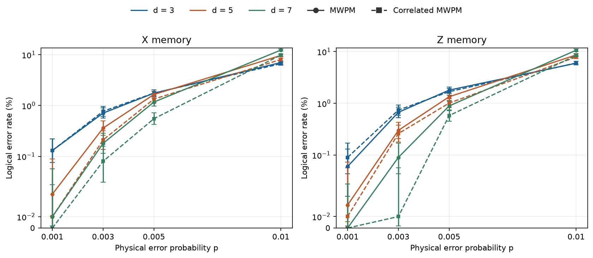
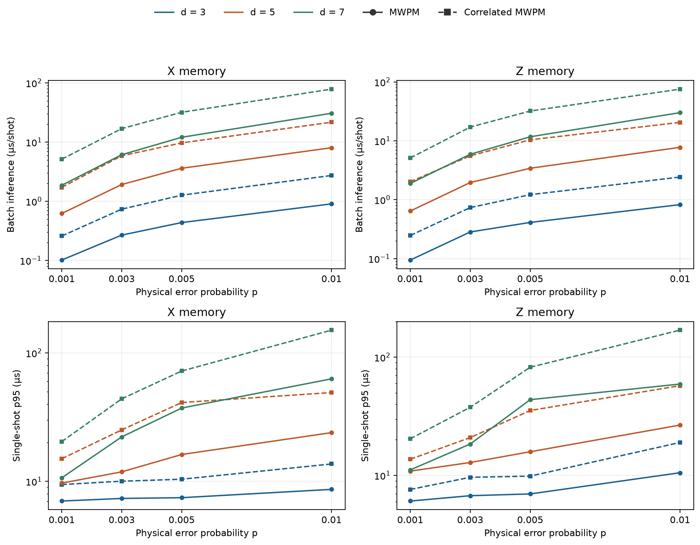
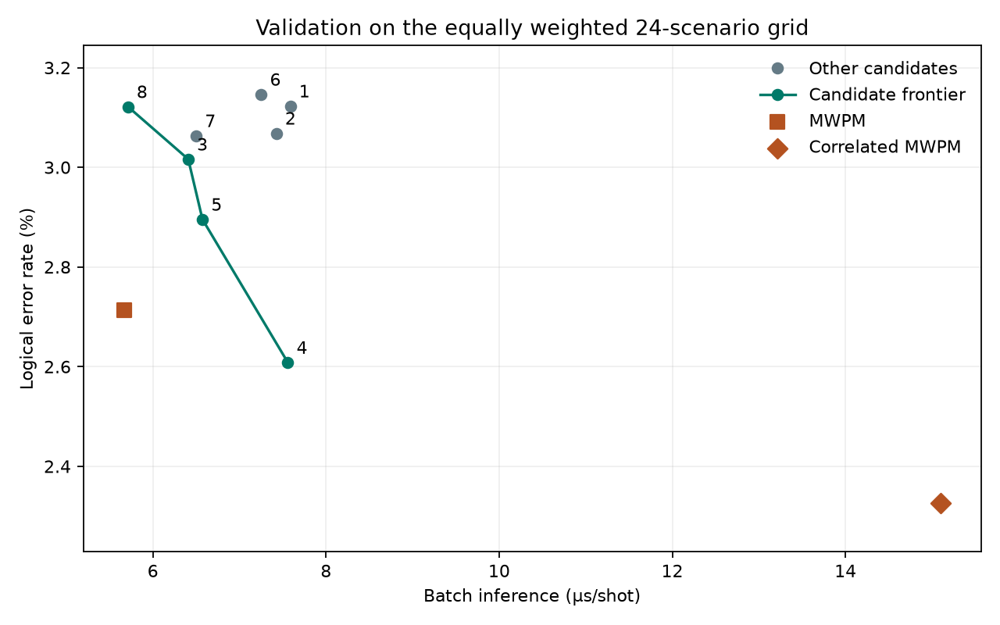

# Iteration 02 · Benchmark expansion and decoder search

On 240,000 paired surface-code shots, ordinary MWPM failed 6,545 times and correlated MWPM failed 5,614 times. Correlated inference took 14.54 µs per shot in batch, compared with 5.48 µs for ordinary matching. The largest absolute reduction in failures occurred at distance 7. These results describe the provisional `simple_uniform` model. The challenge slide specifies Monte Carlo accuracy and decoder timing but leaves the physical channels unspecified.

## Baseline sweep

Each distance contributes 80,000 shots across four physical error probabilities (0.001, 0.003, 0.005 and 0.01) and both memory bases. Rounds equal distance. Every decoder saw the same 10,000 detector records per scenario. The table averages time over the eight equally weighted scenarios at each distance.

| Distance | MWPM failures | Correlated failures | MWPM batch µs/shot | Correlated batch µs/shot |
|---:|---:|---:|---:|---:|
| 3 | 1,811 | 1,785 | 0.42 | 1.20 |
| 5 | 2,201 | 1,877 | 3.49 | 9.68 |
| 7 | 2,533 | 1,952 | 12.54 | 32.75 |

Across the grid, both decoders succeeded on 231,987 shots and both failed on 4,146. Ordinary matching alone failed on 2,399 and correlated matching alone failed on 1,468. Correlated matching recorded fewer failures in 17 scenarios, more in five, and tied in two. At distance 7 and `p = 0.001`, both decoders recorded zero Z-memory failures. Each still has a Wilson 95% upper bound of 0.0384%. That case merits a larger independently seeded run if decisions depend on its error rate. [Paired counts](experiments/iteration-02/sweep/paired.csv) · [Measurements and intervals](experiments/iteration-02/sweep/benchmark.csv)

Batch values use the median of three warm, full-batch decode calls. For single-shot latency, the harness times 128 individual calls and checks each prediction against its batch result. For example, distance-7 X memory at `p = 0.01` gave 30.70 µs/shot in batch and a 62.82 µs single-shot p95 for ordinary matching. Correlated matching measured 78.46 µs/shot and 150.38 µs, respectively. The setup clock includes compilation and warm-up. Stim sampling, inference, and scoring have separate boundaries. All measurements are local to this host. [Sweep manifest and dependency versions](experiments/iteration-02/sweep/manifest.json)

## Eight-trial random-search control

The seeded search drew eight distinct policies uniformly from 1,000 possible distance-dependent configurations. All eight completed training and validation. Each policy saw 240,000 common training shots. Validation began once the eighth training slot closed, then all policies and both reference matchers saw a fresh common set of 240,000 shots. The sampler reserved a fourth seed namespace for final testing. The original simulator and its four noise channels stayed fixed throughout.

| Same-sample validation comparison | Failures / 240,000 | Logical error rate | Batch µs/shot |
|---|---:|---:|---:|
| Ordinary MWPM reference | 6,511 | 2.713% | 5.67 |
| Random trial 4 | 6,260 | 2.608% | 7.56 |
| Correlated MWPM reference | 5,584 | 2.327% | 15.10 |

Trial 4 had the fewest validation failures among the eight candidates. It scaled temporal weights by 0.75 at distance 3, used correlated matching at distance 5, and used ordinary matching at distance 7. Against ordinary MWPM, trial 4 recovered 1,014 shots the baseline missed and missed 763 that it recovered. Against correlated MWPM, trial 4 recovered 1,135 exclusive shots and missed 1,811. This is a candidate for an intermediate runtime budget. Selection used validation, so a final-test result is still needed. [Trial 4 paired measurements](experiments/iteration-02/random/measurements/004-validation.json)

Trials 3, 4, 5 and 8 formed the empirical frontier among candidates. Including the two fixed references leaves trial 4 as the only sampled candidate on the combined frontier. Small timing differences can move those boundaries. The history retains every policy, both split summaries, uncertainties, and trial status. The per-scenario files retain circuit and sample hashes plus individual batch timings. [Trial history CSV](experiments/iteration-02/random/history.csv) · [Trial history JSON](experiments/iteration-02/random/history.json) · [Fixed references](experiments/iteration-02/random/validation-references.json)

## Reproduction and verification

The sweep and campaign manifests contain their exact CLI commands. Use a fresh output directory for a replay. The search sampler uses root seed 2026 and the proposal sampler uses seed 17. Timings use three repetitions on this Windows CPU with Python 3.11.4, Stim 1.16.0 and PyMatching 2.4.0. Fixed seeds reproduce samples on a matching simulator version, instruction set, and batch size. [Setup and commands](README.md) · [Search manifest and split seeds](experiments/iteration-02/random/manifest.json)

The 21 passing tests cover the original CLI, noiseless scoring, Wilson bounds, multi-observable failures, valid and invalid policies, edge topology and weight effects, native prediction parity, deterministic seeds and proposals, common-sample replay, sealed validation, the reserved final split, failed and duplicate trials, and Pareto selection. Unit tests exercise the external-proposal interface using fixtures. The experimental campaign used random proposals only.

## Iteration 03 · Structured quantum bath decoder

The proposed contribution uses the time series of a dual-rail qubit's calibration signal to infer coherent exchange with its near field. Summary values such as T₁ and T₂ describe decay and dephasing. The time series can also contain oscillation frequency, phase, and recurrence information. The Zenodo abstract reports using Fourier features, PCA, and gradient-boosted regression followed by a physics-model fit. Its results describe the author's simulations. The team's model-guided check and post-check pulse train are the experiment below. [Zenodo record](https://zenodo.org/records/24326452)

1. **Infer and validate the bath map.** Use the mentor's notebook to identify the calibration inputs, Hamiltonian, measurement model, and time units. Fit full traces from the calibration split and predict rail occupancy on held-out baths or traces. Compare with a baseline that uses only T₁/T₂ summaries and with an exact-model oracle in simulation. Report trajectory and return-time errors, including uncertainty under readout noise and drift. Keep model fitting offline.
2. **Time the erasure check.** Within a fixed wait budget, schedule the check near a predicted peak of the total one-excitation probability on the rails. The physical check reports whether the excitation is on the rails. Count rejected shots and track the logical state of accepted shots, since high total rail occupancy alone does not establish logical-state fidelity.
3. **Test repeated common-phase pulses.** After a successful check, apply a π phase to both rails relative to the bath. In the one-excitation model, this changes the sign of rail–bath hopping while preserving relative phase between ideal rail states. Sweep pulse spacing against the exchange timescale and compare ongoing pulses with a pulse train stopped early. Record residual exchange, logical-state fidelity, pulse overhead, and sensitivity to timing and pulse error. Suppression and its duration are measured outcomes. [Parity-kick mechanism](https://arxiv.org/abs/quant-ph/9808055)
4. **Isolate the contributions.** On held-out bath instances, compare a fixed-clock check and a map-timed check, each with and without the pulse train. Hold the underlying baths, number of checks, and observation window fixed. Plot measured and predicted rail occupancy with check times, then compare retained fraction, conditional fidelity, and total storage success across conditions.
5. **Connect to decoding.** If the physics model supports a calibrated stochastic error channel and observable erasure flags, generate detector samples and score decoder predictions against hidden logical flips. Run ordinary, correlated, and bath-aware decoding on common samples from each condition to distinguish gains from physical control and gains from decoder side information. Report paired logical failures and runtime. Use the bath model for the novelty demonstration and the organizer's model for the fixed-noise comparison unless the organizers supply compatible channels and heralds.

## Optional follow-on · Generative AI decoder design

1. **Freeze the comparison.** Obtain the organizer circuit or channel specification, interface, and timing rule. Record the circuit hash. If those details remain open, continue under the provisional model and label the experiment accordingly. Choose fresh roots for both arms since the Iteration 02 validation results are public. Preregister the grid, batch size, number of independent campaigns, per-campaign budget, timing repetitions, and policy-selection rule.
2. **Give both arms the same information and budget.** For each root, start one random campaign and one guided campaign with eight slots each, identical shot seeds, and identical decoder choices. Give Codex the proposal schema, common starting information, and its own training feedback. Save the actual prompt, model identifier, raw response, rationale, accepted configuration, and any rejection with the trial. Charge each model proposal to a slot, including invalid or duplicate proposals. Report offline model cost and time separately.
3. **Select from validation once.** Close proposals before releasing validation for either arm. Compare each arm's frontier to both fixed references. If the organizers supply a time budget, lock the lowest-validation-LER policy within it. Otherwise preregister a common runtime cap or fixed set of caps before either search. Repeat across paired campaign roots to distinguish proposal strategy from a lucky draw.
4. **Open the final split only for frozen policies.** Implement a separate final-evaluation command that accepts the frozen policy hashes and protocol. Sample each final scenario once and pass identical detector events to both finalists and both controls. Report paired failure differences with stratified confidence intervals, inference time, compilation time, and single-shot latency. Export the chosen static policy and benchmark its deployment with the model service disconnected.

## Judged submission

- **Measure parallel scaling.** Partition a fixed syndrome batch across independent workers using one precompiled decoder per worker. Check that reassembled predictions match the serial run in shot order. Report wall time, throughput, speedup, worker count, and dispatch cost. Measure single-shot latency separately and distinguish parallel decoding across shots from parallel work within one decode.
- **Prepare the repository and talk.** Document the decoding steps, dependencies, and contribution. Identify ordinary and correlated MWPM as library baselines and weight and distance choices as policy variants. Reproduce the metric tests from a clean checkout. In the 10-minute talk, use 2 minutes for dual-rail erasures and the baseline, 3 for bath inference and check timing, 3 for the pulse-train comparison and decoder evidence, and 2 for limitations and questions.

