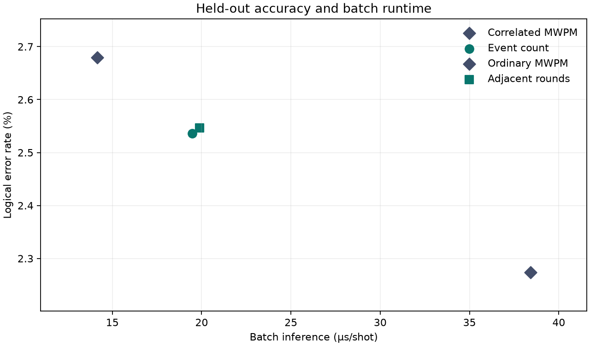
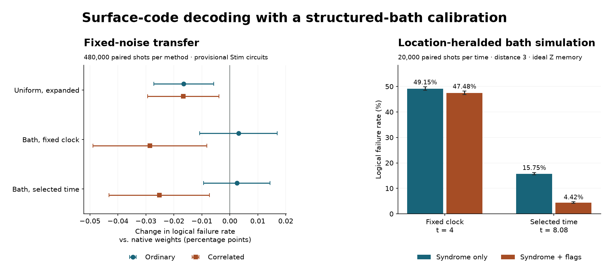

# Iteration 03 · Adaptive surface-code decoding

The decoder uses the observed syndrome to choose one of two precompiled PyMatching decoders. It defaults to ordinary matching and sends selected syndrome buckets to correlated matching. In a batch, it restores predictions to the original shot order. It also supports individual shots and independent chunks.

## How the rule is learned

We compare the two matchers on each training shot and count ordinary-only and correlated-only failures within syndrome buckets. The first feature bins the number of detection events. The second adds the number of adjacent occupied detector rounds. Within each circuit, we rank buckets by the number of recoveries minus regressions, divided by the bucket population plus 256. A bucket needs at least 12 disagreements and a positive net recovery. We fit three training routing caps, 25%, 50%, and 75%, per feature. The resulting lookup table stores the selected buckets. Its runtime inputs are detector bits and the precompiled detector error model.

The experiment evaluates both MWPM references and all six routers on independent validation shots. At each illustrative cap of 1.5× and 2× ordinary batch time, it freezes the eligible policy with the fewest logical failures. It then tests the selected adaptive profiles and the references on a fresh split. At inference, each shot goes to exactly one matcher. The timing includes feature extraction, routing, and restoring output order. The temporal feature draws on the structured-bath idea that time structure carries information. This experiment leaves every circuit and sample stream fixed across decoders.

## Replay and judge circuit

The default uses the 24-scenario provisional grid from Iteration 02. Supply the official circuit as a `.stim` file to use its channels and detector layout directly. The batch caps are examples until the competition's scoring rule is available. If the judges score end-to-end single-shot latency, compare that metric directly. [Experiment commands and deployment API](README.md#adaptive-decoder-for-the-fixed-noise-challenge)

## Held-out results

The final split contains 480,000 common shots across 24 scenarios, with 20,000 per scenario. Every policy used the same Stim circuit and detector samples as both references. Validation selected adjacent-round routing at the 1.5× time cap and event-count routing at the 2× cap.

| Decoder | Failures | Logical error rate | Batch µs/shot | Routed to correlated | Median scenario single-shot p95 |
|---|---:|---:|---:|---:|---:|
| Ordinary MWPM | 12,861 | 2.6794% | 14.15 | 0% | 66.72 µs |
| Event-count router | 12,173 | 2.5360% | 19.46 | 18.37% | 72.53 µs |
| Adjacent-round router | 12,223 | 2.5465% | 19.89 | 15.67% | 95.04 µs |
| Correlated MWPM | 10,913 | 2.2735% | 38.42 | 100% | 95.19 µs |

On this replay the event-count router reduced failures by **5.35% relative to ordinary matching** and used **49.35% less batch time than full correlated matching**. It corrected 1,853 shots missed by ordinary matching and missed 1,165 that ordinary matching corrected. The paired difference was −0.143 percentage points, with an approximate 95% interval of −0.166 to −0.121 points. Full correlated matching had the lowest error rate. Event-count routing is the intermediate candidate to take forward. The adjacent-round feature did not improve both accuracy and speed over event-count routing on this replay.



The direct single-shot path calls the selected matcher's native single-shot API. Adjacent-round routing uses an occupancy bit mask for circuits with up to 64 distinct detector times. The earlier run and the replay agreed on routing fractions and paired failure counts across all 96 test rows. Absolute runtime varied across the runs, including the references. Use within-run comparisons and remeasure on the judging host.

[Frozen policy and validation choices](experiments/iteration-03/adaptive-optimized/frozen-policies.json) · [Validation CSV](experiments/iteration-03/adaptive-optimized/validation.csv) · [Held-out CSV](experiments/iteration-03/adaptive-optimized/test.csv) · [Manifest and replay command](experiments/iteration-03/adaptive-optimized/manifest.json)

## Structured bath initialization

The offline initializer follows Sakidja's Part 1 layered network and balanced check rule. It fits four couplings and two far-field emission rates to the three prepared-state calibration traces. The forward model evolves seven single-excitation amplitudes. It tracks the probability of emission into the vacuum separately from excitation remaining in the finite bath. This implementation uses the zero-temperature limit and bounded multistart least squares. An optional starting estimate can come from a regressor or a prior cooldown fit. [Sakidja's study](https://zenodo.org/records/24326452) · [Source model and experiment scripts](https://github.com/sakidja/RQL_Quantum_bath)

For a fixed-clock check at \(T\), the initializer scans the window from \(T\) to \(2.5T\) by default. It chooses the lowest predicted conditional nonidentity Pauli probability plus one eighth of the erasure probability. For each candidate it computes the polar frame correction from the rail transfer matrix. The export includes the clock and selected channels, Pauli-twirled bit- and phase-flip priors given a pass, average erasure, and worst-case rail retention over logical inputs. The calibrated rate and minimum return provide different information because the probability of passing can depend on the logical input.

On a synthetic split-attachment bath, the fit used 257 samples and held back every fifth time point, 64 in total. The held-out trace RMSE was \(2.96\times10^{-14}\). The fitted model and synthetic oracle both selected \(t=8.08\) for \(T=4\) in dimensionless model units. Evaluating the fitted frame against the synthetic oracle gave these channel probabilities.

| Check | Erasure | Joint pass and nonidentity Pauli |
|---|---:|---:|
| Clock at \(t=4\), oracle frame | 60.57% | 9.63% |
| Bath-selected at \(t=8.08\), fitted frame | 23.54% | 0.26% |

This comparison uses noiseless calibration traces from one bath generated by the fitted model family. The selected check waits 2.02× as long as the clocked check. The result measures the modeled channel at those two times. Hardware drift, measurement error, pulse trains, and surface-code logical error rate require different experiments. [Calibration profile](experiments/iteration-03/bath-calibration/bath-profile.json) · [Check window](experiments/iteration-03/bath-calibration/check-window.csv)

The input `.npz` needs arrays `times` and `traces`. Supply increasing nonnegative model times and a finite `(time, preparation, observable)` array ordered by preparations `+, L, R` and observables `X, Y, Z`. Supply unconditional logical expectations, with observations outside the rails contributing zero. If using `--initial`, provide JSON keys `j_sb`, `j_l1`, `j_l12`, `j_l2`, `gamma_l1`, and `gamma_l2` in the paper's units and fit ranges. The report records fit convergence, held-out trace residual, and whether the requested check window exceeds the calibration record.

The initializer exports the calibration for downstream use. The transfer experiment below defines a mapping to generated surface-code data idles. The location-heralded simulation separately supplies a flag at each data site. [Calibration commands](README.md#initialize-the-structured-bath)

## Bath-initialized surface-code decoding

We used the archived synthetic calibration to initialize two matching decoders. For a given check time, take the fitted probabilities of X, Y, and Z given a pass and divide each by their sum. This gives the relative frequencies of the three axes among nonidentity pass errors. For each pre-round data-qubit idle, the decoder uses that mixture with the circuit's original total idle error probability. The assignment of the calibrated rail axes to the surface-code data axes is an experimental assumption. Each matcher receives every syndrome, with ordinary circuit timing and no per-shot erasure information. The bath-selected time labels the source of the weights in this experiment.

The initializer checks the full input circuit against Stim's generated provisional circuit and finds the idle locations using the corresponding idle-only circuit as a template. It builds a decoder-side detector error model with the chosen Pauli mixture. The evaluator samples the original circuit once per scenario. A uniform control uses the same independent-X/Y/Z encoding as the bath decoder with equal axis probabilities. This matters because an equivalent physical channel can yield a different decomposed matching graph. [Implementation and deployment example](src/bascd/bath_prior.py) · [Stim's Pauli channel definitions](https://github.com/quantumlib/Stim/blob/main/doc/gates.md)

We ran two independent seeds across the full 24-scenario provisional grid with 10,000 shots per scenario and seed. Each of eight configurations decoded all 480,000 shots. The main comparison used the fixed-clock calibration. The fitted selected-time calibration was a secondary comparison. The table gives logical failures for correlated matching. Batch times are within-run medians per scenario, averaged over equally sized scenarios. Host timing varied between runs.

| Decoder initialization | Seed 602711 failures | Seed 602712 failures | Pooled logical error rate | Batch µs/shot, run 1 / run 2 |
|---|---:|---:|---:|---:|
| Native correlated MWPM | 5,530 | 5,503 | 2.2985% | 14.33 / 30.53 |
| Equivalent uniform expansion | 5,509 | 5,444 | 2.2819% | 14.56 / 29.17 |
| Fixed-clock bath weights | 5,489 | 5,407 | 2.2700% | 14.39 / 27.19 |
| Selected-time bath weights | 5,459 | 5,453 | 2.2733% | 14.38 / 32.14 |

The fixed-clock bath decoder recovered 1,310 native failures and introduced 1,173, a net reduction of 137. Its paired LER difference was −0.0285 percentage points (approximate 95% interval −0.0489 to −0.0082). Against the expanded uniform control it recovered 1,262 and introduced 1,205, a net reduction of 57 (−0.0119 points, interval −0.0322 to +0.0084). The control accounts for part of the observed change. The remaining difference permits either a small benefit or a small penalty from the bath-axis bias. Intervals are stratified by scenario and seed, with no adjustment for multiple comparisons. Ordinary matching recorded 12,824 native failures, 12,745 with uniform expansion, 12,839 with fixed-clock bath weights, and 12,836 with selected-time weights.

The prespecified fixed-clock correlated candidate merits testing alongside native correlated matching and the equivalent uniform control on an organizer circuit with a verified idle-site map. A competition score and hardware calibration are still open. [First run](experiments/iteration-03/bath-transfer/summary.json) · [Independent replay](experiments/iteration-03/bath-transfer-replication/summary.json) · [Per-scenario measurements and latency](experiments/iteration-03/bath-transfer-replication/benchmark.csv) · [Paired comparisons](experiments/iteration-03/bath-transfer-replication/paired.csv)

### When the decoder observes an erasure location

For the research control, we simulated a distance-3 Z memory with one independent effective bath channel per data site, followed by ideal checks. A successful check uses the fitted frame and conditional Pauli distribution. On an erasure the simulator flags the location and applies a uniformly drawn I, X, Y, or Z to the qubit, modeling complete depolarization. The blind decoder uses the marginal bit-flip probability. The location-aware decoder gives flagged sites zero matching weight and uses the calibrated pass weight at the other sites. The evaluator keeps the actual Pauli draws and logical parity private.

| Physical check time, model units | Blind MWPM | Location-aware MWPM | Blind-only / location-aware-only failures |
|---|---:|---:|---:|
| Fixed, 4.00 | 9,829 / 20,000 (49.145%) | 9,497 / 20,000 (47.485%) | 2,617 / 2,285 |
| Bath-selected, 8.08 | 3,150 / 20,000 (15.750%) | 885 / 20,000 (4.425%) | 2,379 / 114 |

At the selected time, revealing the locations reduced failures by 2,265 on identical shots. The longer wait changes the physical channel between rows. This model assumes perfect flags, independent sites, ideal syndrome measurements, and cost-free frame correction. It tests one error opportunity in one memory basis. A device-level claim would require measured flags, realistic cycle times, and repeated noisy rounds. [Research control and Wilson intervals](experiments/iteration-03/bath-erasure-control/result.json) · [Sakidja's reference implementation](https://github.com/sakidja/RQL_Quantum_bath)



Error bars on the left show approximate 95% intervals on paired differences from native matching. The right panel shows Wilson 95% intervals for each logical failure rate.

To reproduce the second seed and pooled figure, first run the commands in the README, then run these commands from the same PowerShell session. Model compilation, sampling, three batch repeats, and 64 individual latency probes per scenario are recorded separately in the run files. [First manifest](experiments/iteration-03/bath-transfer/manifest.json) · [Replay manifest](experiments/iteration-03/bath-transfer-replication/manifest.json)

```powershell
& $python -m bascd.bath_transfer --profile $profile --out results/transfer-replication --seed 602712
& $python scripts/plot_bath_results.py results/transfer/summary.json results/heralds/result.json results/transfer-replication/bath-decoder-results.png --replication results/transfer-replication/summary.json
```
