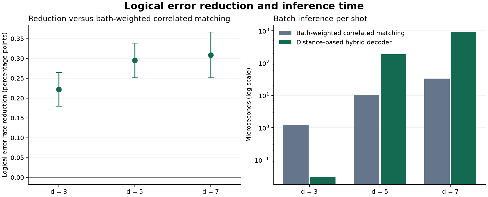

# Iteration 04 · Selecting the lowest-error decoder

We compared decoders on the 24 provisional `simple_uniform` scenarios. The objective was the fewest failed logical observables. The distance-based hybrid decoder uses one rule per code distance, shared across both bases and all four error probabilities. The team locked those rules and their settings after validation, before sampling the final test. The bath research simulation has a different physical channel and contributes zero shots to these results.

## Held-out result

The distance-based hybrid decoder produced **9,460 failures in 480,000 shots (1.9708%)**, the lowest aggregate rate among the four held-out comparisons. It made 1,321 fewer errors than bath-weighted correlated matching, a **12.25% relative reduction**. It recovered 3,012 of that method's failures and introduced 1,691 failures on other shots. The absolute reduction was 0.2752 percentage points (approximate paired 95% interval 0.2472 to 0.3032). Against belief matching it recovered 1,257 and introduced 851, a reduction of 0.0846 points (interval 0.0658 to 0.1033). These intervals use independent shots stratified by the 24 fixed scenarios. [Held-out summary](experiments/iteration-04/accuracy/summary.json) · [Paired disagreements](experiments/iteration-04/accuracy/paired.csv)

| Method | Distance 3 failures | Distance 5 failures | Distance 7 failures | Overall LER | Batch µs/shot |
|---|---:|---:|---:|---:|---:|
| Standard correlated matching | 3,474 | 3,719 | 3,789 | 2.2879% | 15.03 |
| Bath-weighted correlated matching | 3,392 | 3,665 | 3,724 | 2.2460% | 14.87 |
| Belief matching | 3,285 | 3,302 | 3,279 | 2.0554% | 314.74 |
| Distance-based hybrid decoder | **3,037** | **3,193** | **3,230** | **1.9708%** | **364.34** |

Each distance contributed 160,000 fresh shots. At distance 3 the posterior lookup took about 1.47 seconds to compile and averaged 0.03 µs per shot in batch. At distances 5 and 7 the composite averaged 187.39 and 905.61 µs/shot. Accuracy improved at each distance. Bath-weighted correlated matching, which uses the fixed-clock calibration, provides much higher throughput on the larger codes. The hybrid decoder recorded fewer failures than bath-weighted correlated matching in 20 scenarios, tied in three, and recorded more in one. Bath-derived weights supply two ensemble votes. The paired comparison measures the whole decoder, including belief propagation and the search referee. The organizer's circuit and score formula are needed to translate this provisional result into a competition score. [Scenario rates, Wilson intervals and latency](experiments/iteration-04/accuracy/test.csv) · [Run manifest](experiments/iteration-04/accuracy/manifest.json)



## Fresh Stim shot archive

With the same distance-based hybrid decoder and a new root seed of 954130, Stim 1.16.0 sampled 24 serialized circuits at 10,000 shots each. The sample contains 2,571,967 detection events across 186,990 shots with at least one event. Stim recorded 46,671 raw logical observable flips before decoding. We scored each decoder by comparing its predicted logical flip to the recorded flip on every shot.

| Decoder | Median logical success | Best observed logical success | Median batch time (µs/shot) |
|---|---:|---:|---:|
| Standard correlated matching | 99.37% | 100.00% | 5.36 |
| Bath-weighted correlated matching | 99.39% | 100.00% | 5.57 |
| Distance-based hybrid decoder | 99.47% | 100.00% | 167.06 |

Logical success is the fraction of shots for which the predicted logical flip matches Stim's recorded flip. The median and best columns summarize the 24 scenario rates. The time column takes the median of the 24 batch decoding times per shot. All three decoders had zero failures in 10,000 shots for each distance-7 memory basis at `p=0.001`. The per-scenario Wilson 95% interval for success in those cases is 99.9616–100%.

Pooling all 240,000 shots gives logical error rates of 2.2971% for standard correlated matching (5,513 failures), 2.2546% for bath-weighted correlated matching (5,411), and 1.9075% for the distance-based hybrid decoder (4,578). The hybrid decoder's pooled success rate is 98.0925%. [Pooled counts and batch throughput](experiments/iteration-04/stim-shot-archive/summary.json)

The hybrid decoder recovered 1,559 shots that bath-weighted correlated matching missed and failed on 726 that bath-weighted correlated matching decoded correctly. This reduced the failure rate by 0.3471 percentage points (approximate paired 95% interval 0.3081–0.3860). At distance 7 and `p=0.001`, each basis had zero observed failures in 10,000 shots and a Wilson 95% upper limit of 0.0384%. At `p=0.01`, distance-7 failure rates reached 7.50% in X memory and 6.93% in Z memory. Rounds equal distance throughout. Error bars in the figure are per-scenario Wilson 95% intervals. [Per-scenario statistics](experiments/iteration-04/stim-shot-archive/stats.csv) · [Logical error rate by physical error probability](experiments/iteration-04/stim-shot-archive/logical-error-rates.png)

The archive stores each gate-level `circuit.stim`, its detector shots, evaluator-only observable flips, and three sets of predictions. An independent verifier recounted every failure and paired outcome, then regenerated the detector and observable files byte for byte on the original host. Stim's `b8` format stores one byte-aligned row per shot. Use the associated circuit to obtain the number of detectors or observables. [Portable shot archive](experiments/iteration-04/stim-shot-archive.zip) · [Reproduction commands](README.md#generate-and-verify-stim-samples) · [Stim result formats](https://github.com/quantumlib/Stim/blob/main/doc/result_formats.md#the-b8-format)

## How the candidates work

| Candidate | Decision from the syndrome |
|---|---|
| Standard and bath-weighted correlated matching | Both use PyMatching's two-pass correlated matcher. The bath-weighted method uses weights from the earlier synthetic calibration at the fixed check time. |
| Three- and five-member matching ensembles | Vote among matching graphs. The five-member ensemble uses native, fixed-clock, and selected-time correlated graphs, plus two seeded perturbations of the native fault weights. Every voter sees the same input. |
| Small maximum-likelihood table | Sum the probabilities of all fault patterns with each logical outcome for each syndrome. Look up the more probable outcome. The table fits the 24-detector distance-3 circuits. |
| Belief matching and its fixed-clock bath-weighted variant | Run 12 iterations at most of product-sum belief propagation on joint faults. Use the resulting correction if it explains the syndrome, otherwise run matching with posterior fault weights. |
| Bounded fault search | Search joint fault sets in two detector orders. If the search exhausts its budget, use either correlated MWPM or belief matching according to the candidate. |
| Disagreement resolution | Run belief matching and the five-member ensemble. If they disagree, use bounded search. If the search exhausts its budget, keep the belief-matching prediction. The second disagreement rule uses fixed-clock bath-weighted belief matching in place of the ensemble. |

For the small table, the sign of the difference between the joint probabilities of a syndrome with logical value zero and one determines its logical prediction. We compute that difference for every syndrome with a Walsh–Hadamard transform of the circuit's independent fault mechanisms. The implementation records its floating-point error estimate and bounds table size at 24 detectors. For larger circuits the search cap is 5,000 queued states, beam parameter 5. The campaign runs the belief and search backends with up to four CPU threads per batch. PyMatching runs through its existing batch interface. [Small-code implementation](src/bascd/exact_small.py) · [Belief matching paper](https://doi.org/10.1103/PhysRevX.13.031007) · [Bounded search method](https://github.com/quantumlib/tesseract-decoder) · [Native backend used in this campaign](https://pypi.org/project/stabilizer-qec/2.1.0/)

## Selection and replay

Each distance had 80,000 validation shots spread equally across the eight basis and noise settings. The campaign ranked candidates by total validation failures within distance, with a fixed tie order. It wrote the winners, full settings, bath ratios, and circuit fingerprints before sampling any final-test shots. The final test used 20,000 fresh shots in each scenario. Every comparator saw the same detector records and every logical label stayed in the evaluator. The exact and search models use the physical Stim fault mechanisms. Bath variants change only the decoder hypothesis.

Standard correlated matching and bath-weighted correlated matching served as references on the test split. Belief matching with the ordinary fault priors provided a third comparison for the distance-based hybrid decoder. The saved measurements include one warm timed batch per candidate and scenario plus 32 single-shot latency samples. A warm batch was chosen to keep the expensive search practical across the full grid. Wall times include all deployed decision and fallback logic.

| Distance | Selected decoder rule | Validation failures out of 80,000 | Runner-up failures |
|---|---|---:|---:|
| 3 | Logical posterior lookup | 1,447 | 1,476 for both fault-search fallback variants |
| 5 | Resolve ensemble and belief disagreements with search | 1,553 | 1,559 for search with belief fallback |
| 7 | Resolve ensemble and belief disagreements with search | 1,611 | 1,661 for search resolving the two belief decoders |

On validation, the winning larger-code rule needed the search referee on 923 of 80,000 distance-5 shots and 1,225 of 80,000 distance-7 shots. When the two predictors agree, the deployed decoder returns their shared logical bit immediately. The campaign screened the component predictions in full and compared each assembled rule on identical inputs. Tests check the resulting predictions against the deployed paths shot by shot. [Validation measurements](experiments/iteration-04/accuracy/validation.json) · [Saved decoder policy and complete ranking by distance](experiments/iteration-04/accuracy/frozen-policy.json)

```powershell
$python = ".\.venv\Scripts\python.exe"
& $python -m pip install -e ".[dev,hypergraph]"
& $python -m pytest -q
& $python -m bascd.accuracy_campaign --profile experiments/iteration-03/bath-calibration/bath-profile.json --out results/accuracy-replay --seed 44712030 --validation-shots 10000 --test-shots 20000 --repeats 1 --latency-shots 32
& $python scripts/plot_accuracy.py results/accuracy-replay results/accuracy-replay/frontier.png
```

To use the distance-based hybrid decoder, supply the exact calibrated circuit. The loader checks its SHA-256 fingerprint and compiles the selected decoder. LLM inference and logical labels are unnecessary during deployment.

```python
from bascd.accuracy_decoders import load_frozen_decoder
from bascd.circuits import memory_circuit

circuit = memory_circuit("z", distance=5, rounds=5, p=.005)
decoder = load_frozen_decoder("experiments/iteration-04/accuracy/frozen-policy.json", circuit)
events = circuit.compile_detector_sampler(seed=42).sample(128)
predictions = decoder.decode_batch(events)
```

For a file-based submission, the CLI reads detector-only Stim `b8` shots and writes one packed observable record per shot in original order. It accepts a partial final batch and refuses a truncated shot or an existing output path.

```powershell
& $python -m bascd.decode_accuracy --policy experiments/iteration-04/accuracy/frozen-policy.json --circuit calibrated.stim --dets detectors.b8 --out predictions.b8
```

For replay on Windows, Linux, or macOS, install the versions in the run manifest, including the pinned native search backend. Search tie-breaking can depend on the platform. Independently benchmark a supplied organizer circuit before assigning it a distance-specific policy.

The file decoder also accepts `--deduplicate`. It checks for repeated syndromes within a batch and restores the original shot order. Across a separate 8,192-shot Z-memory timing check, every output bit matched direct inference. At distance 5 and `p=.001`, 2,048 shots contained 834 distinct syndromes and median time fell from 47.89 to 41.01 µs/shot. The other three settings moved by less than 1% in either direction, so the option defaults to off. [Timing measurements](experiments/iteration-04/batch-dedup/measurements.json) · [Replay settings](experiments/iteration-04/batch-dedup/manifest.json)
