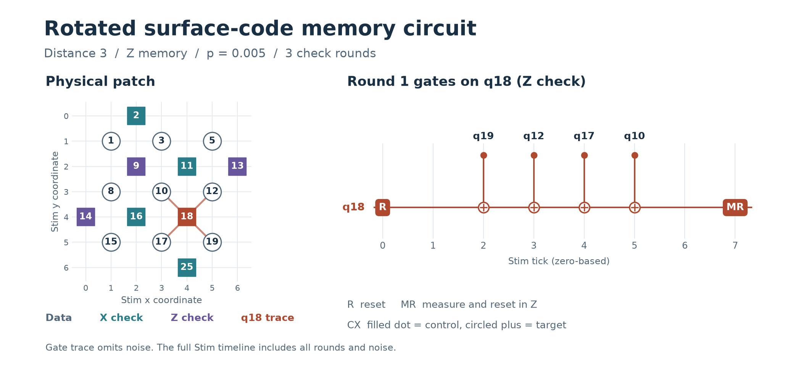
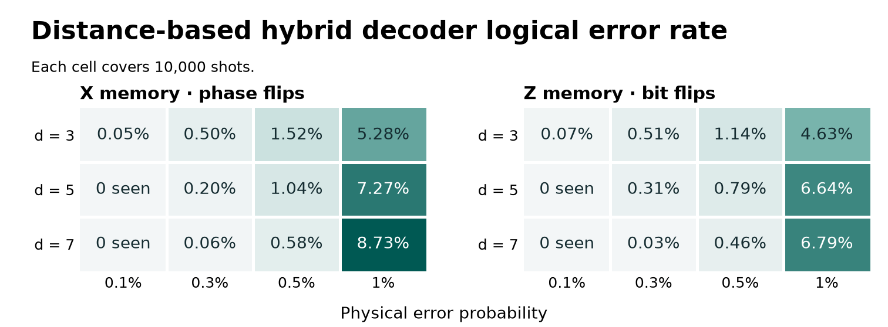

# Decoding a surface code memory

Missouri State University Quantum Bears • MidQWest 2026 • Northrop Grumman decoder challenge

### Abstract

A quantum memory can register warning signs of an error while leaving its stored information unread. A decoder uses those signs to decide whether the final answer needs to be flipped. We built a **distance-based hybrid decoder** that chooses its method according to the size of the surface code. On 240,000 simulated trials, it made **4,660 wrong predictions (1.9417%)**, compared with **5,411 (2.2546%)** for standard correlated matching. The gain came at a substantial cost in computing time. We also tested Dr. Ridwan Sakidja’s proposal to learn from the time history of a qubit’s surroundings. That idea helped in a separate simulation with visible loss flags. Its contribution to the main decoder remains uncertain.

### What one logical error looks like

A surface code spreads one unit of quantum information, a **logical qubit**, across several physical qubits. Neighboring groups undergo repeated checks. An unexpected change in a check produces a detection event. The collection of events over space and time is the **syndrome**, the evidence available to the decoder. Several different faults can produce the same evidence. The decoder needs to infer their effect on the stored information. [1, 2]



*Figure 1. An actual 17-qubit benchmark circuit. Nine data qubits store the information. Eight check qubits help read its syndrome. The highlighted check collects information from four neighbors before it is measured and reset. The diagram shows one round of gates on that check.*

On the sixth trial of this circuit, one detector fired at the highlighted location in time step 2. The hybrid decoder predicted no logical flip (0). The simulator recorded a flip (1). That mismatch counted as one wrong logical prediction. The hybrid decoder missed 114 of 10,000 trials at this setting, an observed rate of **1.14%** with a 95% confidence interval of **0.95% to 1.37%**. [5]

## How we built and tested the decoder

### A fair comparison

We used Stim to generate noisy circuits and PyMatching to run the baseline decoders. Each circuit stored one logical qubit. A Z-memory experiment tests whether the decoder catches the effect of a logical bit flip. An X-memory experiment tests whether it catches the effect of a logical phase flip. We used code distances 3, 5 and 7. Distance is the minimum number of physical qubit errors in an undetectable logical operation on the code. Each memory ran as many check rounds as its distance. [1–3]

We tried four physical error probabilities per noise location, 0.1%, 0.3%, 0.5% and 1%. The provisional model, called `simple_uniform`, applies noise after gates, after resets, before measurements and to idle data qubits before each round. Combining three distances, two bases and four probabilities gives **24 circuit settings**. Within each setting, every decoder received identical syndrome records. Only the evaluator saw Stim’s recorded logical flips.

### From matching to a policy by distance

**Start with matching.** Minimum-weight perfect matching (MWPM) connects detection events to one another or to a boundary using likely fault paths. Correlated matching also uses information about faults that can cause several related events. An initial 2,000-shot smoke test checked the pipeline. On the subsequent 240,000-shot comparison, ordinary matching missed 6,545 shots and correlated matching missed 5,614. [6]

**Try cheaper decisions first.** We built a reproducible search over distance-dependent choices and weights for events across rounds or at boundaries. Eight randomly chosen policies established a control for future AI experiments. A separate adaptive decoder sent only selected shots to correlated matching. Routing by the number of events cut errors by 5.35% relative to ordinary matching and used about half the batch time of full correlated matching in its own held-out run. Full correlated matching still made fewer errors. [6]

**Choose the final rule on validation data.** At distance 3, a lookup table combines the modeled probabilities of faults for each possible syndrome and returns the more probable logical bit. The number of possible syndromes grows too quickly for that table at larger distances. At distances 5 and 7, a belief-matching decoder estimates which faults are likely, and five matching decoders vote on a second answer. If the two answers agree, the policy returns that bit. If they disagree, it searches plausible fault combinations up to a fixed limit, then falls back to the belief result if needed. Two of the five voters use bath-derived weights. [6]

We selected the hybrid decoder’s settings on 80,000 validation shots per distance and locked them before the final test. The deployed decoder takes detector events from a calibrated circuit and runs locally without a language model.

## Accuracy and computing time

**Table 1.** Each shot is one run of a noisy circuit. All three decoders processed the same 240,000 shots, with 10,000 per setting. The time column gives batch decoding time after warm-up divided by the number of shots, measured on the project host. This timing excludes compilation, sampling and scoring. [5]

| Decoder | Wrong logical predictions | Logical error rate | Batch µs per shot |
| --- | ---: | ---: | ---: |
| Standard correlated matching | 5,411 | 2.2546% | 14.66 |
| Bath-weighted correlated matching | 5,362 | 2.2342% | 14.74 |
| Distance-based hybrid decoder | 4,660 | 1.9417% | 380.16 |

Standard correlated matching uses the circuit’s fault probabilities. Bath-weighted correlated matching uses the same algorithm with weights derived from a bath model at a fixed check time. The hybrid decoder corrected 1,597 shots the standard matcher missed and missed 846 shots it got right. That gives **751 fewer failures** on the same trials, a **13.88% relative reduction**. The absolute reduction was **0.313 percentage points**, with an approximate paired 95% confidence interval of **0.273 to 0.353 points**. The hybrid took about **26 times as long per shot in batch**. A single request can take a different amount of time.



*Figure 2. At 0.5% physical error in X memory, the observed failure rate fell from 1.52% at distance 3 to 0.58% at distance 7. At 1% physical error the ordering reversed. “0 seen” means zero failures in 10,000 shots. Each such cell still has a Wilson 95% upper bound of 0.0384%.*

An earlier held-out test of **480,000 different shots** found the same accuracy ordering. The distance-based hybrid decoder missed 9,460 (1.9708%), belief matching missed 9,866 (2.0554%), bath-weighted correlated matching missed 10,781 (2.2460%), and standard correlated matching missed 10,982 (2.2879%). This test used 20,000 shots per setting. Both comparisons support an accuracy gain for the complete policy on the simulated circuits. [6]

## What a bath can tell a decoder

In Sakidja’s model, a qubit stores an excitation on two paths called rails. The excitation can move into its surroundings, the **bath**, and later return. A check asks whether the excitation is on the rails. A relaxation or coherence time summarizes a decay curve, but two curves with similar decay times can have different return times. Sakidja proposed fitting the time-dependent signal so that the check can be scheduled near a predicted return. [4]

### A timing experiment

We fitted six bath parameters to simulated calibration traces from three prepared states. The fit used 257 time points and held out 64 from the same synthetic bath. The model selected time 8.08 in place of the fixed check at 4.00, in model units. The predicted chance of finding the excitation off the rails fell from **60.57% to 23.54%**, at a cost of waiting about twice as long. These numbers describe erasure at a check. Surface-code logical failure is a different measurement. [6]

We then asked what a decoder could do with a flag identifying the site of an erasure. Each row below compares two decoders on the **same 20,000 shots** of a simulated distance-3 Z memory. Changing the time between rows changes the physical channel. [6]

**Table 2.** Logical failures with and without erasure locations in the bath simulation.

| Physical check time | Locations hidden | Locations supplied |
| --- | ---: | ---: |
| Fixed at 4.00 | 9,829 (49.145%) | 9,497 (47.485%) |
| Selected at 8.08 | 3,150 (15.750%) | 885 (4.425%) |

At the selected time, the flags prevented a net **2,265 failures**. The simulation assumes perfect flags, independent sites, one error opportunity per site and ideal checks. The proposal to follow the check with repeated phase pulses on both rails to suppress renewed exchange still needs an experimental test. [4, 6]

### Carrying the idea into the fixed circuit

The benchmark supplies detector bits on a fixed clock. We used the bath fit to change the relative weights the decoder gives to possible bit and phase errors during data-qubit idles. Stim still sampled the original noise at the original times. The decoder received no erasure flags. This tests whether the bath can supply useful initial guesses, or **priors**, when the physical circuit is already set.

In a dedicated 480,000-shot comparison, fixed-clock bath weights yielded **10,896** failures. An otherwise equivalent model with uniform weights yielded **10,953**. The estimated bath advantage was **0.0119 percentage points**, with a paired 95% interval from **−0.0084 to +0.0322**. That interval includes zero. The large gain with perfect erasure flags and the smaller, uncertain gain from changing weights answer different questions. The full decoder also uses a lookup table, voting and search, so its total gain cannot establish the bath’s individual contribution. [6]

## What the results mean for the challenge

On the circuits we could test, choosing a decoder by code distance reduced logical errors even against a strong belief-matching reference. The practical choice depends on the time available to act on each syndrome. Most of the computing cost came from the larger codes. In the 480,000-shot held-out test, distance-3 table lookup averaged about 0.03 µs per shot after compilation, compared with about 187 µs at distance 5 and 906 µs at distance 7. Independent shots can be divided among workers. A measured speedup curve on the judging machine is still needed. [6]

The organizer brief calls for decoder code and metric tests in a public repository, plus a roughly ten-minute explanation. It also values novelty, parallelizability and code quality. The supplied materials leave the official circuit noise and scoring formula open. Gate and readout fidelities describe individual hardware operations, while our percentages describe failure of an entire simulated logical memory. The next competition test is to freeze policies for the organizer’s circuits and measure both logical accuracy and latency on the judging hardware.

Sakidja also proposed an offline generative-AI search for decoder settings. The repository has a working random-search control, a structured proposal format and a shared scoring pipeline. Comparing an actual model-guided search against random search still requires equal trial budgets, common training and validation shots, and a fresh final test after both policies are frozen. [6]

### How to check our numbers

The audit regenerated all 240,000 shots from their circuits and seeds, reran the three decoders from detector inputs, and matched **all 720,000 predictions** to the saved bits. It reproduced the 72 scenario-level error rates and confidence intervals as well as all 48 paired comparisons. From the repository root, the following command repeats the audit in the project Python environment. [5]

```text
python scripts/audit_decoder_rates.py experiments/iteration-04/screen-run-954131
```

### References and project records

[1] A. deMarti iOlius et al. Decoding algorithms for surface codes. [arXiv:2307.14989v4](https://arxiv.org/abs/2307.14989v4).

[2] C. Gidney. Stim: a fast stabilizer circuit simulator. Quantum 5, 497 (2021). [Paper](https://doi.org/10.22331/q-2021-07-06-497).

[3] O. Higgott and contributors. PyMatching, the matching decoder used for the baselines. [Software](https://github.com/oscarhiggott/PyMatching).

[4] R. Sakidja. Erasure Check Timing from an Inferred Structured Bath: Dual Rail Qubits with Near Field Memory. [Author’s code and study materials](https://github.com/sakidja/RQL_Quantum_bath).

[5] Quantum Bears. Stim archive with root seed 954131. [Run report](experiments/iteration-04/screen-run-954131/Decoder%20results.md), [audit](experiments/iteration-04/screen-run-954131/error-rate-audit.json) and [per-setting counts](experiments/iteration-04/screen-run-954131/stats.csv).

[6] Quantum Bears. [Baseline](Iteration%2001.md), [search trials](Iteration%2002.md), [bath and routing experiments](Iteration%2003.md) and [policy selection and held-out tests](Iteration%2004.md).
