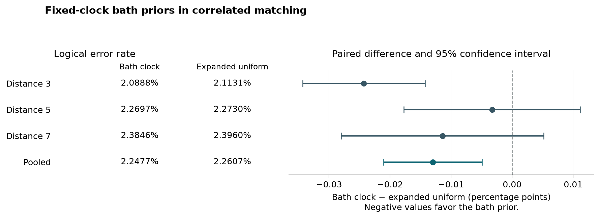

# What the structured bath contributes to a surface-code decoder

One question connects the four teaching notebooks. If a qubit can exchange a photon with its surroundings, what evidence can the decoder actually see when it must predict a logical error?

## What the four modules establish

| Teaching notebook | Physical or software lesson | Implication for the challenge |
| --- | --- | --- |
| Module 1, *Surface Code*, steps 27–30 and 34–39 | Repeated syndrome measurements reveal detection events. A heralded erasure supplies an additional bit identifying an affected site and round. | Score the predicted logical flip against Stim's hidden observable. On a circuit that supplies heralds, compare using and ignoring them on the very same records. |
| Module 2, *Dual Rail and RQL*, steps 15–23 and 33–35 | A qubit stores information in which of two rails holds a photon. A total-occupancy check can detect loss while preserving that distinction. A returning photon can still carry a relative phase error. | A flag identifies a location with unreliable data. Even a genuine flag does not tell the decoder which Pauli occurred. A passed check can still leave a silent error. |
| Module 3, *Structured Quantum Bath*, calibration and fit sections | Oscillation frequencies and decay envelopes in simulated time traces constrain couplings and loss rates. The notebook combines spectral features, regression and a physics fit. | Calibration is an offline operation. A syndrome is a parity-change record. Inferring a device-specific bath from syndromes alone would need separate validation. |
| Module 4, *Dual Rail with Structured Bath*, steps 24–35 | The model predicts both erasure probability and the residual Pauli mixture at a given time. The time-selection rule trades off these two quantities and accounts for a logical frame correction. | Fixed-clock weights can initialize the decoder. Retiming physical checks changes the sampled channel. Compare that controller at a stated clock period and report elapsed physical time as well as error per round. |

The supplied notebooks contained source cells with no saved execution outputs. Their simulations and the source study provide physical motivation. The numbers below come from running our repository code. Dr. Ridwan Sakidja developed the structured-bath proposal. Our contribution here is the mapping onto matching weights and the controlled transfer test. [Sakidja's model, code and simulation tables](https://github.com/sakidja/RQL_Quantum_bath)

## Fixed-circuit test

The decoder takes the fitted fixed-clock X/Y/Z probabilities conditional on a pass and a nonidentity Pauli. Their relative weights for this synthetic profile are 79.21%, 3.97% and 16.82%. They redistribute the decoder's assumed round-start data-idle fault probability. Stim samples the original circuit at its original times. Every shot contributes to the denominator, including those on which the decoder fails. Calibration and graph construction happen once offline. Online, the decoder sees only detector bits. [Calibration profile](../iteration-03/bath-calibration/bath-profile.json) · [Decoder implementation](../../src/bascd/bath_prior.py)

The primary control uses equal axis probabilities and exactly the same procedure for converting them into matching edges. This control matters because changing the representation of equivalent physical faults can itself change how PyMatching decomposes the graph. Comparing against both native and expanded-uniform matching shows which conclusion depends on that choice. [Prespecified comparison and replay command](protocol.md)

### Results on three million fresh Stim shots

All eight configurations saw the same 125,000 shots per scenario, across both memory bases, three distances and four physical noise probabilities. Logical error is the fraction of complete memory experiments decoded incorrectly. Batch time starts with the detector records in host memory.

| Decoder | Logical failures / 3,000,000 | Logical error | Batch µs/shot |
| --- | ---: | ---: | ---: |
| Ordinary PyMatching, native graph | 80,963 | 2.6988% | 5.50 |
| Correlated PyMatching, native graph | 68,350 | 2.2783% | 14.62 |
| Correlated PyMatching, equal-axis control | 67,821 | 2.2607% | 14.79 |
| Correlated PyMatching, fixed-clock bath prior | 67,431 | **2.2477%** | 14.61 |
| Correlated PyMatching, selected-time bath prior | 67,836 | 2.2612% | 14.67 |

The fixed-clock prior corrected 7,795 control mistakes and introduced 7,405, for **390 fewer logical failures**. That is a reduction of **0.0130 percentage points** (paired 95% interval 0.0049–0.0211), or about 130 fewer failures per million records in this equally weighted workload. Of the 919 fewer failures versus native correlated matching, 529 were already obtained by the equal-axis control. The batch times are descriptive measurements from one warmed batch per case. [All eight decoder results](run/summary.json) · [Paired scenario counts](run/paired.csv) · [Setup, batch and single-shot timing](run/benchmark.csv)



The direction varied by memory basis. Against equal-axis correlated matching, the fixed-clock prior prevented 579 net failures in X memory and added 189 in Z memory, each on 1.5 million shots. In ordinary matching, the same prior added 557 failures against equal-axis ordinary matching. The result supports this particular prior with correlated matching on the pooled grid. It does not establish that the simulated circuit contains a physical bath or that a future judge circuit will favor the same prior. A basis-dependent policy suggested by these secondary results would need independent confirmation.

Verification reproduced every circuit and detector-plus-observable sample fingerprint from the recorded seeds. A direct PyMatching replay at distance 5, X memory and physical error probability 0.005 reproduced the primary pair's 188 recoveries and 208 regressions. The audit reconciles all eight configurations, counts and scenario identities against the saved summaries and regenerates the figure.

```sh
python experiments/bath-confirmation-01/summarize.py --run experiments/bath-confirmation-01/run --figure results/my-bath-weights.png
```

## What a real erasure flag would buy

We also ran the location-aware research decoder on a simulated distance-3 Z memory. Each of nine data sites saw one effective bath channel, followed by ideal checks. The flag-aware and blind decoders saw the same physical faults and syndrome for each row. The blind decoder knew the correct marginal flip probability. The flag-aware decoder additionally knew which sites reported erasure. Neither decoder received the Pauli draws. [Research decoder](../../src/bascd/bath_erasure.py)

| Check time in model units | Logical errors with flags hidden | Logical errors with flags visible |
| --- | ---: | ---: |
| Fixed clock, 4.00 | 9,810 / 20,000 (49.050%) | 9,296 / 20,000 (46.480%) |
| Bath-selected time, 8.08 | 3,155 / 20,000 (15.775%) | 920 / 20,000 (4.600%) |

At the selected time, location information fixed 2,360 mistakes and introduced 125, for 2,235 fewer logical failures on identical shots. Comparing the two columns isolates the value of the flag. Comparing the two rows changes both elapsed physical time and the channel, with independent samples. The simulation assumes independent sites, ideal heralds, ideal readout and a free frame correction. Continuous phase-flip protection would need its own pulse-level test. [Counts, assumptions, seeds and uncertainty](flag-demo.json) · [Stim's heralded erasure definition](https://github.com/quantumlib/Stim/blob/main/doc/gates.md#the-heralded_erase-instruction)

## What to show the judges

The Northrop Grumman scoring slide asks for Monte Carlo logical error across distances and error rates, timed decoder inference, and credit for original implementation and algorithm design. The companion brief also asks for public code with metric tests and a roughly ten-minute talk. Neither supplied slide specifies the exact judge circuit, side inputs or a numerical scoring formula. The team's `simple_uniform` workload is provisional.

1. **Begin with a measured decoder result.** Show identical held-out shots, logical failures per 100 shots and inference time side by side. At distance 3, Z memory and 0.5% physical error, the team's posterior lookup reached 1.4850% at 0.038 µs/shot in batch. Ordinary PyMatching on those records reached 1.7537% at 0.470 µs/shot. This example is circuit-specific. Show the larger-distance results on their own axes. [Held-out comparison](../../Circuit%20decoder%20speed%20and%20accuracy.md) · [Distance-5 and distance-7 tradeoffs](../compute-frontier-02/summary.md)
2. **Use the bath to explain a decision.** Draw two error chains consistent with a syndrome. Show how a calibrated prior changes their relative weights, or how a measured erasure on one chain makes it more plausible. Credit Sakidja's physics and PyMatching's solver. Point to the code the team wrote and identify the uniform control.
3. **Present the flag result as a second experiment.** Label the measured input, physical check time and idealizations on the figure. For the official run, the question for the sponsor is “Which circuit or detector records will you score, and will decoders receive any herald bits or independent calibration traces?” A permitted calibration should match the device or circuit and use a verified map from sites, axes and rounds to decoder edges. Until those inputs are specified, the detector-only result is the one to quote for the fixed-circuit benchmark.

To reproduce the herald comparison from the repository root with the project environment active, choose a new file path.

```sh
python -m bascd.bath_erasure --profile experiments/iteration-03/bath-calibration/bath-profile.json --output results/my-bath-flags.json --distance 3 --shots 20000 --seed 914233
```
