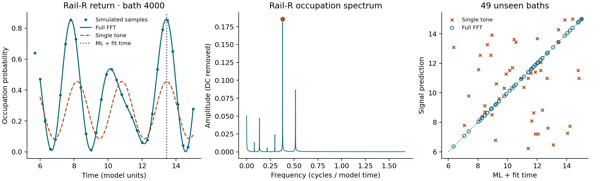

# Predicting check times from simulated rail returns

The full phase-preserving Fourier reconstruction recovered the published ML + physics fit's selected check time for **49 of 49** unseen baths at clock period 6. These times also match the published exact-model choices. A single occupation tone recovered **4 of 49**, even with its measured phase. [Per-bath results](per_bath.csv)

| Timing rule | Exact grid matches | Within one grid step (0.06) | Mean absolute timing error | Largest error |
| --- | ---: | ---: | ---: | ---: |
| Full complex spectrum | 49 / 49 | 49 / 49 | 0 | 0 |
| Strongest occupation tone | 4 / 49 | 5 / 49 | 2.302 | 6.78 |

Fitted and full-spectrum times ranged from 6.36 to 15 model time units. Three baths selected the upper window limit. Single-tone times ranged from 6.24 to 15. For bath 4001, the strongest occupation frequency was 0.170 cycles per model time and gave 7.20. Combining the tones put the best return at 12.06, the published fitted time. Over the 49 baths the strongest frequencies ranged from 0.000667 to 0.430 cycles per model time. One bath selected the lowest positive frequency bin, which can include slow decay over the record.

At the selected checks the inferred return magnitude ranged from 0.7175 to 0.9944, giving erasure probabilities of 0.56% to 24.26%. The largest frame-phase difference from the exact polar correction was 6.8e-9 radians or less. At each selected time, direct simulation agreed with the reconstructed erasure and conditional Z probabilities to within 8.8e-9 and 1.9e-9, respectively. Across the full candidate grid, the independently reconstructed R occupation and squared return magnitude differed by at most 5.2e-8.



The calibration record spans the entire decision window and consists of noiseless simulated expectations. The result tests interpolation and check selection in this first-attachment model. The finite-shot simulation below tests measurement noise. Timing on changed baths after calibration, future-time extrapolation, and other attachments remain unverified. Each plotted frequency is in model units, with no hardware timing conversion assumed.

## Calibration and prediction

Each of 49 unseen baths starts in its ground state. The first attachment couples only rail R to the bath, and the model has zero direct rail dephasing. We regenerated expectation values at the author's 5,000 sample times from 0 through 1,500. The six published true parameters per bath are used only by the simulator and the subsequent physical-channel validation. The predictor receives three real time series and the known sample spacing. Bath labels enter only when predictions are scored. [Model and calibration routine](https://github.com/sakidja/RQL_Quantum_bath/blob/94572516042297d6b6018fe76eb2f2b547e3c46f/part1/dual_rail_structured_bath.py) · [Published input parameters](https://github.com/sakidja/RQL_Quantum_bath/blob/94572516042297d6b6018fe76eb2f2b547e3c46f/part1/results_v3_final8_one_gamma_sys_0.0/raw_parameters_per_bath.csv)

For a balanced rail input, the measured quadratures give $C(t)=\langle X\rangle+i\langle Y\rangle$. The uncoupled left rail has return magnitude one, so $C$ is the complex right-rail return amplitude relative to the left. A separate preparation on R gives the right-rail occupation $q=-\langle Z\rangle_R=|C|^2$. This equality uses the cold, single-excitation model and the uncoupled left rail. A decay jump leaves the rails empty.

We Fourier-interpolate the three sampled records, retaining every complex coefficient. At time zero the extension reflects X and occupation evenly and Y oddly. From time 750 through 1,500 a half cosine tapers each trace to zero before the reflected copy. These choices keep the preparation boundary and the far-end periodic join away from the check window's interior. We evaluate the inverse transform on the published 151-point grid from 6 through 15, in steps of 0.06. We keep the earliest time in a numerical tie.

After removing the relative phase $\arg C$, the retained rail amplitudes are $1$ and $r=|C|$. The mean erasure probability is $(1-r^2)/2$. The conditional unflagged Z probability is $(1-r)^2/[2(1+r^2)]$, with zero X and Y probabilities. We minimize conditional Z error plus one eighth of erasure probability on the grid, the author's balanced objective. Both terms decrease over $0\le r\le1$, so maximizing the return magnitude gives the same time. Selecting the time needs relative spectral phases between tones to reconstruct the return, while the instantaneous relative rail phase supplies the frame correction.

The single-tone comparison takes the largest nonzero positive-frequency DFT coefficient of the mean-subtracted R-occupation record. It keeps the measured DC, amplitude, phase and frequency, then picks the largest reconstructed occupation on the same grid. This identifies the best point for that one sinusoid, including endpoints. The comparison uses the raw record without tapering. Neither predictor reads fitted parameters, selected times or training baths. The program finishes predicting for all baths before opening the published reference table.

## Finite calibration shots

For each bath and shot budget we generated 16 independent complete calibration records, then applied the same Fourier interpolation and grid rule. For each balanced input and each quadrature, a projective logical Pauli measurement returns +1 or −1 inside the rails and 0 outside. If the ideal quadrature expectation is $s$ and the probability of remaining inside is $p=(1+q)/2$, the three outcome probabilities are $(p+s)/2$, $(p-s)/2$ and $1-p$. The independent R-preparation occupancy measurement is Bernoulli with probability $q$. Each time, observable, bath and repeat uses fresh draws. Sampling all three observables at 5,000 times consumes 15 million or 150 million simulated preparations per bath calibration. The timing rule uses two of these ensembles, and the third measures occupancy independently.

Independent quadrature noise can give a reconstructed magnitude above one. We project these values to one while preserving their angle and choose the earliest equal-cost candidate. The same bound leaves every noiseless decision unchanged. Of 784 records in each budget, 63 at 1,000 shots and zero at 10,000 shots needed a projection anywhere on the candidate grid. No smoothing, fitting or shot-budget-specific tuning was used.

| Shots per time and observable | Exact matches | Within 0.06 | Mean absolute timing error | Mean actual erasure at chosen time | Excess over optimal erasure |
| ---: | ---: | ---: | ---: | ---: | ---: |
| 1,000 | 155 / 784 (19.8%) | 377 / 784 (48.1%) | 0.2773 | 8.2198% | 0.4916 percentage points |
| 10,000 | 310 / 784 (39.5%) | 589 / 784 (75.1%) | 0.1355 | 7.8385% | 0.1103 percentage points |

The noisy records revisit the same 49 baths. The baseline mean erasure at their noiseless optima is 7.7282%. After selecting each time from the noisy record, an independent forward propagation evaluated the actual erasure and the conditional Z error under its noisy phase correction. Mean conditional Z was 0.4075% and 0.3629% at the two budgets. The largest timing misses were 7.14 and 5.70 model time units, respectively. These are single-round channel probabilities. [Sensitivity summary](sensitivity.json) · [Per-record measurements and scores](sensitivity.csv) · [Sampling and evaluation code](sensitivity.py)

## Reproduction

Use the checkout and package versions recorded in the summary. From the project root, run the following in PowerShell after setting the upstream path. Outputs can be redirected with `--out`.

```powershell
$env:OPENBLAS_NUM_THREADS = '1'
$env:OMP_NUM_THREADS = '1'
python experiments/bath-fft-timing-02/run.py $upstream
python experiments/bath-fft-timing-02/sensitivity.py $upstream
```

[Per-bath predictions and physical-channel checks](per_bath.csv) · [Summary and package versions](summary.json) · [Analysis script](run.py) · [Published reference times](https://github.com/sakidja/RQL_Quantum_bath/blob/94572516042297d6b6018fe76eb2f2b547e3c46f/part1/results_v3_final8_one_gamma_sys_0.0/raw_round_channels_per_bath.csv)


