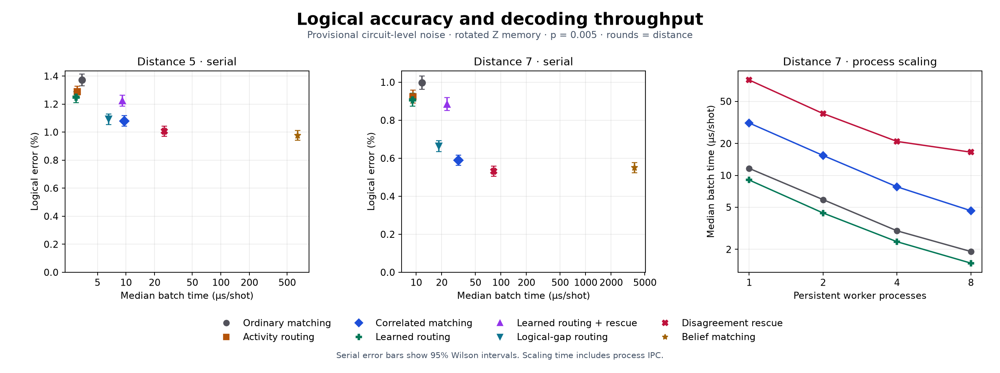

# Circuit-level decoder compute study

The campaign uses provisional simple_uniform, rotated Z memory, p=.005, rounds=distance. Both distance cases use the same model family and one logical observable.

Training and scoring used separate sampler seeds. For the learned policy, d5 used 1,200,000 shots and d7 used 1,200,000 shots. Each distance used 100,000 test shots per seed across 3 held-out seeds. [Protocol](protocol.json)

## Accuracy and serial decoding

Logical failure is measured per complete memory shot. Batch throughput is reported as median wall time per shot on warmed, interleaved serial batches. Single-shot latency is the median duration of a warmed call on one complete detector record. Setup is measured separately from both.

### Distance 5

| Method | Failures / shots | Logical error, % (95% Wilson interval) | Batch, µs/shot | Single, µs | Setup, s |
| --- | ---: | ---: | ---: | ---: | ---: |
| Ordinary matching | 4,114 / 300,000 | 1.3713 [1.3303, 1.4136] | 3.442 | 10.450 | 0.0112 |
| Activity routing | 3,862 / 300,000 | 1.2873 [1.2476, 1.3283] | 3.055 | 26.750 | 0.0241 |
| Correlated matching | 3,241 / 300,000 | 1.0803 [1.0440, 1.1180] | 9.608 | 20.900 | 0.0122 |
| Learned routing | 3,748 / 300,000 | 1.2493 [1.2102, 1.2897] | 2.975 | 78.350 | 0.0810 |
| Learned routing + rescue | 3,673 / 300,000 | 1.2243 [1.1856, 1.2643] | 9.173 | 69.750 | 0.1238 |
| Logical-gap routing | 3,275 / 300,000 | 1.0917 [1.0551, 1.1295] | 6.533 | 42.950 | 0.0799 |
| Disagreement rescue | 3,016 / 300,000 | 1.0053 [0.9703, 1.0417] | 25.430 | 41.400 | 0.0780 |
| Belief matching | 2,927 / 300,000 | 0.9757 [0.9411, 1.0115] | 647.059 | 790.500 | 0.0126 |
| Matched-budget random control | 4,047 / 300,000 | 1.3490 [1.3083, 1.3909] | n/a | n/a | n/a |

Serial batch measurements used 2,048 shots and 11 repetitions.

### Distance 7

| Method | Failures / shots | Logical error, % (95% Wilson interval) | Batch, µs/shot | Single, µs | Setup, s |
| --- | ---: | ---: | ---: | ---: | ---: |
| Ordinary matching | 2,992 / 300,000 | 0.9973 [0.9624, 1.0335] | 11.667 | 22.350 | 0.0234 |
| Activity routing | 2,771 / 300,000 | 0.9237 [0.8901, 0.9585] | 9.189 | 36.650 | 0.0537 |
| Correlated matching | 1,767 / 300,000 | 0.5890 [0.5622, 0.6170] | 31.377 | 54.550 | 0.0283 |
| Learned routing | 2,720 / 300,000 | 0.9067 [0.8734, 0.9412] | 9.069 | 67.900 | 0.0596 |
| Learned routing + rescue | 2,655 / 300,000 | 0.8850 [0.8521, 0.9191] | 23.159 | 61.300 | 0.0774 |
| Logical-gap routing | 1,991 / 300,000 | 0.6637 [0.6352, 0.6934] | 18.555 | 65.350 | 0.0625 |
| Disagreement rescue | 1,593 / 300,000 | 0.5310 [0.5056, 0.5576] | 82.192 | 88.350 | 0.0621 |
| Belief matching | 1,651 / 300,000 | 0.5503 [0.5245, 0.5774] | 3756.227 | 4973.400 | 0.0285 |
| Matched-budget random control | 2,927 / 300,000 | 0.9757 [0.9411, 1.0115] | n/a | n/a | n/a |

Serial batch measurements used 2,048 shots and 11 repetitions.

The matched-budget control used the same number of correlated calls per seed as learned routing. Its calls targeted uniformly sampled shots within each seed. [Accuracy table](accuracy.csv) · [Serial timing](timing.csv) · [Setup](setup.csv)

## Paired accuracy

The four primary comparisons use exact two-sided McNemar tests with a Bonferroni threshold of .0125 per comparison. Error changes are candidate minus baseline in percentage points. The approximate paired 95% intervals are unadjusted. The saved analysis omits intervals for fewer than 30 total disagreements.

| Distance | Candidate | Baseline | Baseline errors recovered | Candidate errors introduced | Change, pp | Approx. 95% interval, pp | Exact p |
| ---: | --- | --- | ---: | ---: | ---: | ---: | ---: |
| 5 | Learned routing | Activity routing | 429 | 315 | -0.0380 | [-0.0558, -0.0202] | 3.32e-05 |
| 5 | Disagreement rescue | Correlated matching | 647 | 422 | -0.0750 | [-0.0964, -0.0536] | 6.16e-12 |
| 7 | Learned routing | Activity routing | 246 | 195 | -0.0170 | [-0.0307, -0.0033] | 0.0172 |
| 7 | Disagreement rescue | Correlated matching | 435 | 261 | -0.0580 | [-0.0752, -0.0408] | 4.36e-11 |

Other comparisons are descriptive. [Paired accuracy table](paired.csv)

## Paired serial timing for learned routing

Speedup is the median of baseline / learned wall-time ratios on matching batch repetitions. Percentile bootstrap intervals resample the saved batch pairs 20,000 times using a fixed random seed. They describe timing variation on this host.

| Distance | Baseline | Learned faster, batches | Median speedup | Bootstrap 95% interval |
| ---: | --- | ---: | ---: | ---: |
| 5 | Activity routing | 9 / 11 | 1.024× | [1.007×, 1.057×] |
| 5 | Ordinary matching | 11 / 11 | 1.152× | [1.113×, 1.160×] |
| 7 | Activity routing | 3 / 11 | 0.986× | [0.941×, 1.023×] |
| 7 | Ordinary matching | 11 / 11 | 1.275× | [1.256×, 1.348×] |

## Routing work on held-out shots

Rates pool the saved per-seed counts. Learned routing, activity routing, and logical-gap routing count correlated calls. Disagreement rescue and learned routing + rescue count belief calls. Full disagreement rescue evaluates correlated matching on every shot. Learned routing + rescue uses the learned correlated route.

| Distance | Activity correlated, % | Learned correlated, % | Logical gap correlated, % | Full rescue belief, % | Learned + rescue belief, % |
| ---: | ---: | ---: | ---: | ---: | ---: |
| 5 | 5.234 | 5.047 | 3.076 | 0.936 | 0.377 |
| 7 | 5.117 | 5.171 | 2.100 | 0.808 | 0.220 |

[Distance 5 route counts](d5/route-counts.csv) · [Distance 7 route counts](d7/route-counts.csv)

## Persistent-process scaling

Each worker compiles its own decoder once. Worker timing includes NumPy transfer through multiprocessing pipes and ordered assembly. The timer starts after worker startup and warmup. Speedup compares paired worker-pool runs against that method’s own one-worker pool.

| Distance | Method | Workers | Shots / batch | Repetitions | Median µs/shot | Speedup vs one worker | Pool setup, s | Pool warmup, s |
| ---: | --- | ---: | ---: | ---: | ---: | ---: | ---: | ---: |
| 7 | Correlated matching | 1 | 8,192 | 9 | 31.218 | 1.000× | 1.9923 | 0.2662 |
| 7 | Correlated matching | 2 | 8,192 | 9 | 15.404 | 2.028× | 1.8741 | 0.1305 |
| 7 | Correlated matching | 4 | 8,192 | 9 | 7.798 | 4.020× | 1.9742 | 0.0699 |
| 7 | Correlated matching | 8 | 8,192 | 9 | 4.635 | 6.874× | 2.4997 | 0.0474 |
| 7 | Disagreement rescue | 1 | 8,192 | 9 | 79.496 | 1.000× | 2.1179 | 0.6582 |
| 7 | Disagreement rescue | 2 | 8,192 | 9 | 38.301 | 2.018× | 1.9320 | 0.3271 |
| 7 | Disagreement rescue | 4 | 8,192 | 9 | 20.910 | 3.587× | 2.2749 | 0.1792 |
| 7 | Disagreement rescue | 8 | 8,192 | 9 | 16.559 | 4.892× | 2.5591 | 0.1062 |
| 7 | Learned routing | 1 | 8,192 | 9 | 9.034 | 1.000× | 1.9703 | 0.0793 |
| 7 | Learned routing | 2 | 8,192 | 9 | 4.411 | 2.044× | 1.9262 | 0.0424 |
| 7 | Learned routing | 4 | 8,192 | 9 | 2.363 | 3.773× | 2.0312 | 0.0275 |
| 7 | Learned routing | 8 | 8,192 | 9 | 1.483 | 6.066× | 2.5652 | 0.0195 |
| 7 | Ordinary matching | 1 | 8,192 | 9 | 11.633 | 1.000× | 1.8623 | 0.0980 |
| 7 | Ordinary matching | 2 | 8,192 | 9 | 5.897 | 2.007× | 2.0412 | 0.0491 |
| 7 | Ordinary matching | 4 | 8,192 | 9 | 2.994 | 3.900× | 1.9824 | 0.0269 |
| 7 | Ordinary matching | 8 | 8,192 | 9 | 1.909 | 6.383× | 2.4358 | 0.0169 |

Host measurements were taken on Windows-10-10.0.26300-SP0 with Python 3.11.4. Timing begins with the complete detector record available in host memory. [Scaling repetitions](scaling.csv) · [Environment and package versions](protocol.json)
