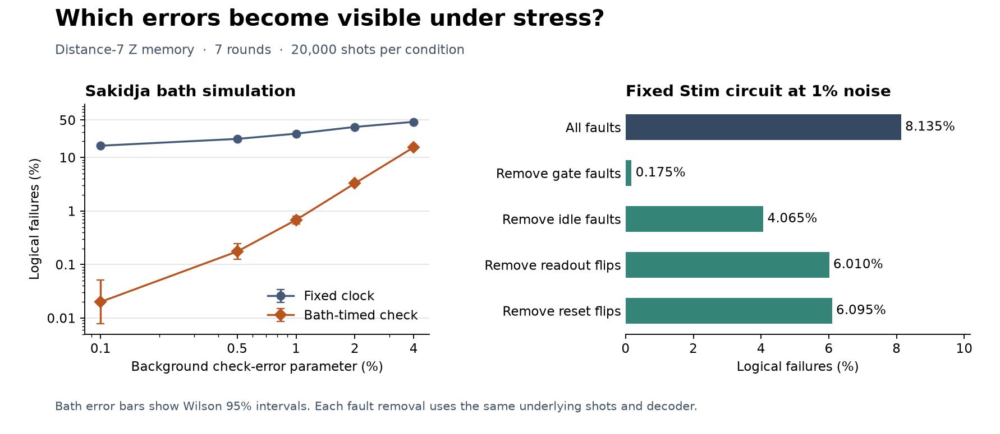

# Categorizing logical failures under higher noise

Use **2% background check noise** to collect failures for Sakidja's timed-check simulation. At distance 7 in Z memory, it gives 656 failures in 20,000 shots (3.280%, Wilson 95% interval 3.042–3.536%). The original 0.1% setting gives only four failures at this sample size. The 2% stress run keeps the fitted check times and loss probabilities, and holds readout and reset noise at 0.1%. Failed shots average 26.27 flagged losses versus 25.00 on successful shots. A flag identifies a loss at a site and round. A logical failure indicates an incorrect prediction for the encoded memory after seven rounds. [Bath results and assumptions](../bath-background-stress-01/README.md)



On the provisional fixed Stim circuit, **1–1.5% physical noise** produces thousands of logical failures per 20,000 shots while the decoders still recover the logical bit substantially more often than chance. Around 4%, their logical error rates approach 50%. This sweep raises the gate, idle, readout and reset rates together. The bath experiment raises a different parameter. [Fixed Stim sweep in X and Z memory](fixed-stim/README.md)

## Which physical fault families contribute?

For each of three noise levels (0.5%, 1%, 2%) we generated 20,000 distance-7 Z-memory records with independent samples for gate faults, round-start data faults, readout flips and reset flips. Stim's Clifford circuit and Pauli faults make detector and logical flips additive modulo two. Combining the four samples gives the complete record. Removing any one sample gives the same underlying shot with only that family's faults removed. The decoder uses the complete circuit's correlated-matching graph throughout and sees only the resulting detector bits.

| Fault family removed at 1% | Logical failures / 20,000 | Logical error | Previously failed shots recovered | Previously correct shots lost |
| --- | ---: | ---: | ---: | ---: |
| None | 1,627 | 8.135% | — | — |
| After Clifford gates | 35 | 0.175% | 1,605 | 13 |
| Round-start data errors | 813 | 4.065% | 990 | 176 |
| Before measurement | 1,202 | 6.010% | 623 | 198 |
| After reset | 1,219 | 6.095% | 625 | 217 |

Gate faults have the largest measured effect in this circuit. Each family acts at a different number of physical opportunities. The table measures its total contribution across the circuit. Of the 1,627 failing shots, **1,368** recovered under at least two different single-family removals. These overlapping contributions explain why assigning one exclusive cause to every failed shot would be misleading. The removal experiments use simulator-only information. [Paired counts and approximate 95% intervals](fault-sources/removals.csv)

## Verification and reproduction

At every noise level we checked the complete joint detector/observable error signatures from the four sources against Stim's native model. All 5,471 signatures matched with a maximum absolute difference below 1.4 × 10⁻¹⁶ in the log parity weights. With independent fresh samples from the native generator, correlated matching gave 128, 1,625 and 8,019 failures at the three increasing noise levels. The composed samples gave 116, 1,627 and 7,953. A second seeded run reproduced the complete removals table byte for byte. [Seeds, fingerprints and model checks](fault-sources/summary.json)

From the repository root with the project Python environment active, choose a new output directory for the fault-removal replay. The plot command reads the stored bath and fault-removal results.

```sh
python experiments/high-noise-categorization-01/fault_sources.py results/my-source-replay
python experiments/high-noise-categorization-01/plot.py
```
