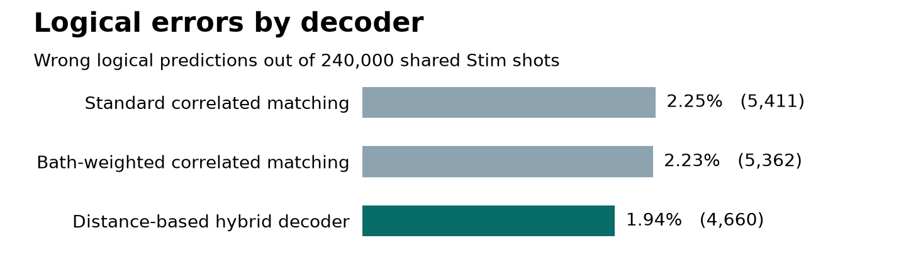
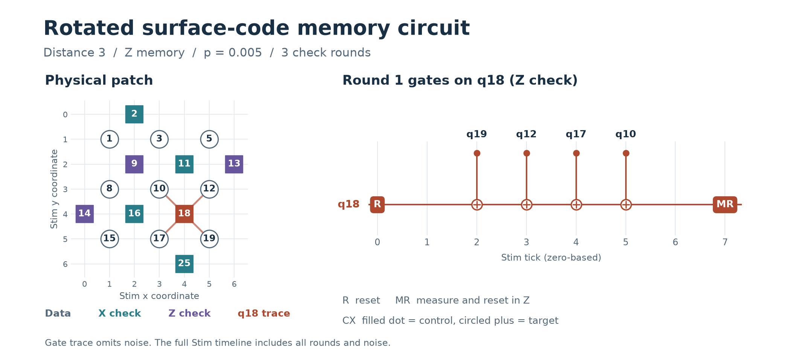
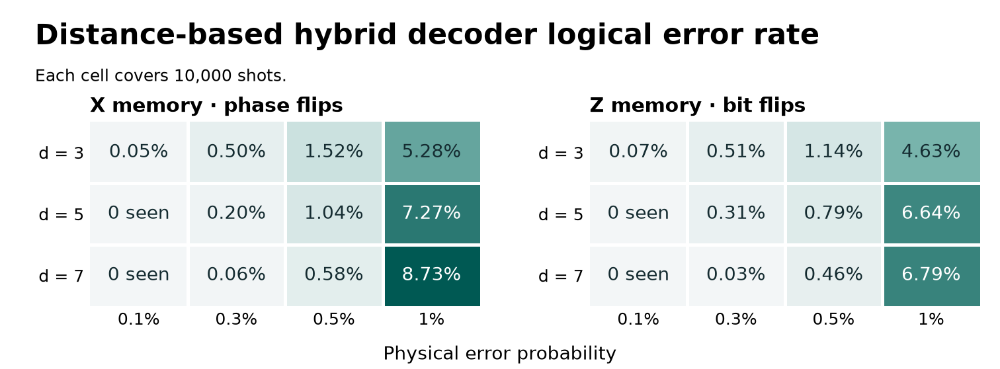

# Decoder results

The **distance-based hybrid decoder** made **4,660 wrong logical predictions in 240,000 shots (1.9417%)**. Standard correlated matching made 5,411, and bath-weighted correlated matching made 5,362 on the same shots.



A shot counts as one **wrong logical prediction** when the decoder's predicted flip differs from Stim's recorded logical flip. The **logical error rate** is that count divided by the number of shots. Each of the 24 circuit settings contributed 10,000 shots under the provisional `simple_uniform` noise model.

Standard correlated matching uses the circuit’s usual fault probabilities. Bath-weighted correlated matching uses the same matching algorithm with weights from a bath model at a fixed check time. The distance-based hybrid decoder uses a lookup table at distance 3. At distances 5 and 7, it compares belief matching with a five-matcher vote and runs a bounded search when they disagree.

## The circuit behind one rate



For this distance-3 Z-memory circuit at 0.5% physical error, **114 of 10,000** predictions by the hybrid decoder were wrong. That gives **1.14%** logical error, with a Wilson 95% confidence interval of **0.95% to 1.37%**. On the sixth shot, the only detection event was at the highlighted check's location, at time step 2. The decoder predicted 0 and Stim recorded 1. [View that shot](syndrome-example.png)

Stim rendered the complete gate schedules, including the noise operations, from the two archived circuit files. [X-memory circuit diagram](circuit-timeline-x.svg) · [Z-memory circuit diagram](circuit-timeline.svg) · [X source](cases/d3-x-p0.005/circuit.stim) · [Z source](cases/d3-z-p0.005/circuit.stim)

## Error by circuit setting



Z memory measures the effect of a logical bit flip. X memory measures the effect of a logical phase flip. Read across a row to change physical error probability, or down a column to change code distance. Each circuit ran for as many rounds as its distance. “0 seen” means zero failures in 10,000 shots. The Wilson 95% upper bound for each such cell is **0.0384%**. [Plot with per-setting confidence intervals](logical-error-by-noise.png)

## Verifying the counts

The audit regenerated all 240,000 shots from the saved circuits and seeds, then ran all three decoders using only the detector inputs. **All 720,000 predictions matched the archived bits.** Comparing the predictions with Stim's recorded logical flips reproduced all 72 error rates and their Wilson intervals, along with all 48 paired comparisons. [Audit results](error-rate-audit.json) · [Per-setting counts](stats.csv) · [Paired outcomes](paired.csv) · [Seeds and versions](manifest.json)

In the raw files, `native` identifies standard correlated matching, `bath_clock` identifies bath-weighted correlated matching, and `frozen` identifies the distance-based hybrid decoder. The last identifier records that the team locked its settings before final testing.

To repeat the audit from the repository root in the project Python environment, run

```console
python scripts/audit_decoder_rates.py experiments/iteration-04/screen-run-954131
```

<details>
<summary>Runtime and logical success by decoder</summary>

| Decoder | Median logical success | Best observed logical success | Median batch time (µs/shot) |
|---|---:|---:|---:|
| Standard correlated matching | 99.34% | 100.00% | 5.40 |
| Bath-weighted correlated matching | 99.37% | 100.00% | 5.41 |
| Distance-based hybrid decoder | 99.50% | 100.00% | 169.83 |

Medians are taken across the 24 circuit settings. The pooled logical error rate above counts failures across all 240,000 shots.

</details>
