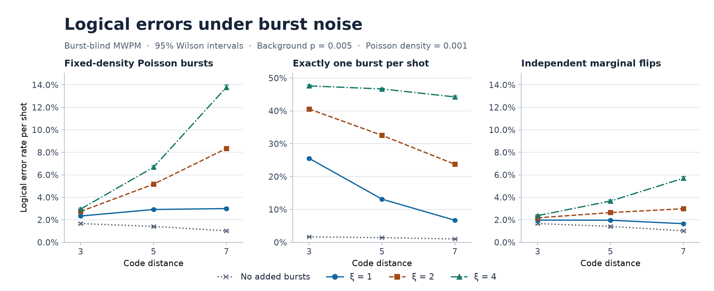

# Spatial burst sensitivity



Spatial bursts are injected on top of the baseline circuit noise. The benchmark uses burst-blind minimum-weight perfect matching (MWPM), with its decoder graph and weights from the baseline circuit. The no-burst control measures that baseline. The independent marginal control matches the single-site, single-round flip probabilities of the fixed-density Poisson model. Burst centers are chosen uniformly over the data sites. The length scale ξ is measured in nearest-neighbor data-qubit spacings. Poisson density is the expected number of burst cores per data qubit per syndrome round.

Rates are logical failures per shot. Error bars show individual 95% Wilson intervals. The table describes the two measured endpoints for each series. Interval overlap is descriptive and does not constitute a test of the difference.

## Background p = 0.005, Poisson density = 0.001

| Exposure | ξ | Smallest d | Largest d | Change (percentage points) | Endpoint comparison |
|---|---:|---:|---:|---:|---|
| No added bursts | — | 3 (1.666%) | 7 (1.021%) | -0.645 | Lower at largest distance, intervals separated |
| Fixed-density Poisson bursts | 1 | 3 (2.337%) | 7 (2.998%) | +0.661 | Higher at largest distance, intervals separated |
| Fixed-density Poisson bursts | 2 | 3 (2.744%) | 7 (8.338%) | +5.594 | Higher at largest distance, intervals separated |
| Fixed-density Poisson bursts | 4 | 3 (2.952%) | 7 (13.79%) | +10.83 | Higher at largest distance, intervals separated |
| Exactly one burst per shot | 1 | 3 (25.55%) | 7 (6.709%) | -18.84 | Lower at largest distance, intervals separated |
| Exactly one burst per shot | 2 | 3 (40.57%) | 7 (23.75%) | -16.82 | Lower at largest distance, intervals separated |
| Exactly one burst per shot | 4 | 3 (47.61%) | 7 (44.25%) | -3.364 | Lower at largest distance, intervals separated |
| Independent marginal flips | 1 | 3 (1.977%) | 7 (1.655%) | -0.322 | Lower at largest distance, intervals separated |
| Independent marginal flips | 2 | 3 (2.174%) | 7 (2.985%) | +0.811 | Higher at largest distance, intervals separated |
| Independent marginal flips | 4 | 3 (2.371%) | 7 (5.693%) | +3.322 | Higher at largest distance, intervals separated |

### Poisson bursts versus independent marginal flips

| ξ | d | Poisson LER | Independent LER | Poisson minus independent (percentage points) |
|---:|---:|---:|---:|---:|
| 1 | 3 | 2.337% | 1.977% | +0.36 |
| 1 | 5 | 2.917% | 1.963% | +0.954 |
| 1 | 7 | 2.998% | 1.655% | +1.343 |
| 2 | 3 | 2.744% | 2.174% | +0.57 |
| 2 | 5 | 5.165% | 2.643% | +2.522 |
| 2 | 7 | 8.338% | 2.985% | +5.353 |
| 4 | 3 | 2.952% | 2.371% | +0.581 |
| 4 | 5 | 6.676% | 3.669% | +3.007 |
| 4 | 7 | 13.79% | 5.693% | +8.092 |

## Interpreting the exposure

The single-burst flip probability at one decay length is 0.5/e, about 18.4%. This length measures spatial reach. The rate of burst starts is an independent model choice. With d² data sites and d rounds, the fixed-density model expects density × d³ burst cores per shot. The middle panel holds exposure at one burst per shot. Its vertical scale accommodates that higher exposure. The outside panels use the same vertical scale.

The independent control uses the odd-flip probability at each site after averaging over core positions and counts. For site j this is (1 − exp(−2 × density × sum of kernel weights to j))/2 per round. This control preserves the mean local fault load while removing the shared core. The sweep measures a finite set of distances in a burst stress test with ordinary matching.

## Reproduce the sweep

For the default study, run from the repository root with the project Python environment. Choose a fresh output directory. The sweep accepts custom lengths, density, distances, shot counts, and seeds.

```sh
python -m bascd.burst_sweep --out results/my-spatial-burst --xi 1 2 4 --density 0.001
python -m bascd.burst_report --run results/my-spatial-burst
```

[Benchmark results](results.csv) · [Run protocol](protocol.json) · [Figure PDF](burst_sensitivity.pdf)
